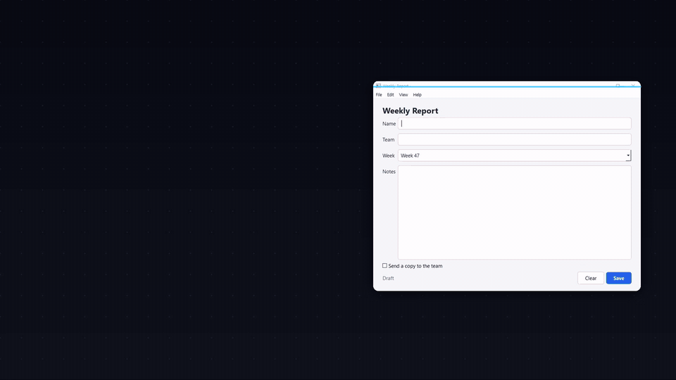

# OnceMacro (원스매크로)

**AI가 화면을 보고 매크로를 만들고, 스스로 고칩니다. 그 뒤엔 AI 없이 혼자 돕니다.**



1분 영상, 소리 있음(mp4 내려받기): [한국어](media/demo/oncemacro_story_ko.mp4?raw=true) · [English](media/demo/oncemacro_story_en.mp4?raw=true) · English README: [README.md](README.md)

AI 에이전트(Claude Code, Codex 등)에게 무엇을 자동으로 할지 말하면 됩니다. AI가 창을 보고 매크로를 쓰고, 실행해 보고, 막히는 곳을 고칩니다. 그다음부터 매크로는 AI 없이 반복합니다. 토큰이 들지 않습니다.

원스매크로는 MCP 서버가 들어 있는 Windows 자동화 프로그램입니다. Claude Code, Codex, Gemini CLI, Cursor 같은 에이전트가
이 프로그램으로 창을 보고, 버튼과 입력칸을 **이름으로** 찾고, 스텝을 하나씩 시험한 뒤 매크로로 저장합니다.
그 매크로는 혼자 돕니다. 토큰도 들지 않고, 화면을 어디로 보내지도 않고, 매번 같은 스텝을 그대로 밟습니다.
오래 도는 매크로가 막히면 프로그램이 알아채고 먼저 스스로 고쳐 보고, 그래도 안 되면(허락했을 때만) AI에게 한 번 묻습니다.

## 설치 (한 줄, PowerShell, 관리자 권한 필요 없음)

```powershell
irm https://raw.githubusercontent.com/j-dev-team/oncemacro/main/install.ps1 | iex
```

프로그램을 `%LOCALAPPDATA%\OnceMacro` 에 풀고, Claude Code·Codex가 설치돼 있으면 MCP 서버를 등록합니다.
또는 Releases 에서 압축 파일을 받아 아무 곳에나 풀고 `app\OnceMacro.exe` 를 실행하세요.

그다음 에이전트에게 이렇게 말해 보세요.

> 매크로 도구로, 메모장에 오늘 날짜를 입력하고 파일을 저장하는 매크로를 만들어 줘.

## AI가 매번 누르게 하면 안 되나요?

PC 한 대에서 쟀습니다(Windows 10, Claude Code 기본 모델, 비용은 정가 기준). 방법과 원래 기록:
[docs/en/BENCHMARK.md](docs/en/BENCHMARK.md) — `scripts/bench_ai_vs_macro.py` 로 누구나 다시 잴 수 있습니다.

| 할 일(한 번) | AI가 매번 함 | AI가 한 번 만든 매크로 |
|---|---|---|
| 메모장: 한 줄 쓰고 저장 | 15.1초, 0.137달러 (5/5) | 1.08초, 0달러 (100/100) |
| 계산기: a × b | 20.0초, 0.159달러 (5/5) | 3.68초, 0달러 (100/100) |
| 매크로 만들기(한 번) | – | 18.5초 / 26.6초, 0.17달러 / 0.20달러 |

메모장 100번: AI가 매번 하면 약 25분·13.70달러, 매크로로 하면 약 2분·0.17달러.

## 할 수 있는 것

- **Windows 프로그램을 요소 이름으로**(UI 자동화): 일반 Win32 프로그램, 탐색기, 오피스, 대화상자, 스토어 앱.
  요소 이름은 해상도·화면 배율·테마가 바뀌어도 대개 그대로입니다(지금까지 PC 한 대에서 시험).
  화면을 직접 그리는 프로그램은 그림과 색으로.
- **뒤에서 실행**(아래 설명): 다른 창 뒤에 가려진 창에서, 내 화면·입력 초점·마우스를 뺏지 않고 돕니다.
  다른 이름으로 저장 대화상자, Ctrl+Shift+S 같은 단축키도 됩니다. **숨겨서 실행**을 켜면 매크로가 도는 동안
  대상 창이 화면에 보이지 않고, 최소화된 창에서도 계속 돕니다(그림 찾기·위치 클릭·화면 읽기 포함, 잰 한계는 아래).
- **웹 페이지**를 요소로(브라우저 자동화), **엑셀·워드·한글(HWP)** 문서를 셀·책갈피·누름틀 이름으로,
  파일, 클립보드, PDF 글자, 메일.
- **막힘 풀기**: 같은 화면에서 같은 스텝을 되풀이하는 걸 알아채고, 증거를 남기고, 팝업 닫기·복구 매크로·쉬기를
  해 보고, 통한 방법을 기억합니다. 다 안 될 때만 AI에게 묻습니다.
- 화면 편집기(한국어·영어), 녹화, 예약 실행, 단축키, 실행 기록.

## 뒤에서 실행 — 매크로가 도는 동안 PC를 그대로 쓰기

대부분의 자동화 도구는 대상 창을 앞에 두고 진짜 마우스를 움직입니다. **뒤에서 실행**을 켜면
원스매크로 매크로는 다른 창 뒤에 있는 창에서 돌고, 그동안 사람은 다른 곳에서 계속 타자를 칠 수 있습니다.
요소 이름으로도 되고, 요소 정보가 없는 프로그램은 그림과 창 안 위치로도 됩니다(화면을 직접 그리는 프로그램으로 운영 중).

**숨겨서 실행과 최소화된 창.** **숨겨서 실행**을 켜면 매크로가 도는 동안 대상 창이 화면에 보이지 않고,
끝나면 원래대로 돌아옵니다. 오류가 나거나 멈췄을 때도, 원스매크로가 갑자기 꺼졌을 때도 몇 초 안에 돌아옵니다.
대상 창이 최소화돼 있으면, 스텝이 화면을 봐야 하거나 위치로 눌러야 할 때 보이지 않게 되살려 쓰고 끝나면 다시 최소화합니다.

PC 한 대(Windows 10)에서 쟀습니다. 칸마다 다른 창에 입력 초점이 있는 상태로 뒤에서 실행을 5번씩 돌렸습니다.
"화면 갱신" = 창이 안 보이는 동안 글자를 넣은 뒤 찍은 화면이 넣기 전 화면과 다름.

| 프로그램 · 창 상태 | 그림 찾기 | 위치 클릭 | 글자 입력 | 화면 찍기 | 화면 갱신 |
|---|---|---|---|---|---|
| 메모장 · 다른 창 뒤 | 5/5 | 5/5 | 5/5 | 5/5 | 5/5 |
| 메모장 · 숨겨서 실행 | 5/5 | 5/5 | 5/5 | 5/5 | 5/5 |
| 메모장 · 최소화 | 5/5 | 5/5 | 5/5 | 5/5 | 5/5 |
| 엑셀 · 다른 창 뒤 | 5/5 | 5/5 | 5/5 | 5/5 | 5/5 |
| 엑셀 · 숨겨서 실행 | 5/5 | 5/5 | 5/5 | 5/5 | 5/5 |
| 엑셀 · 최소화 | 5/5 | 5/5 | 1/5 (다시 재면 2/5) ¹ | 5/5 | 5/5 |
| 계산기 · 다른 창 뒤 | 5/5 | 0/5 ² | 5/5 | 5/5 | 5/5 |
| 계산기 · 숨겨서 실행 | 5/5 | 0/5 ² | 5/5 | 5/5 | 5/5 |
| 계산기 · 최소화 | 5/5 | 0/5 ² | 0/5 | 5/5 | 5/5 |
| 탐색기 · 세 상태 각각 | 5/5 | 안 잼 | 안 잼 | 5/5 | 안 잼 |
| 화면을 직접 그리는 게임 창 · 숨겨서 실행 / 최소화 | 5/5 | 안 잼 | 안 잼 | 5/5 (검은 화면 아님) | 5/5 |

위의 모든 실행이 끝난 뒤 창은 원래 상태로 돌아왔습니다(220/220).
¹ 먼저 클릭하지 않고 글자만 넣을 때: 최소화된 엑셀은 고른 셀을 놓칩니다. 셀을 먼저 클릭하면(위치나 요소로)
5/5이고, 엑셀 스텝(셀을 이름으로)은 화면이 아예 필요 없습니다.
² 계산기(스토어 앱)는 뒤에서 실행일 때 가려지기만 해도 위치 클릭을 무시합니다. 버튼을 요소 이름으로 누르세요.

메모장 요소 스텝, 5번씩(다른 창 뒤 / 최소화): 입력칸에 요소 이름으로 글자 넣고 파일 > 저장 5/5 / 5/5,
다른 이름으로 저장 대화상자 5/5 / 안 잼, Ctrl+Shift+S 5/5 / 안 잼, 요소로 연달아 100번 저장 100/100(다른 창 뒤).

매크로마다 켭니다: 편집기 → 대상 창 → **뒤에서 실행**. 어떤 프로그램에서 뒤에서 실행이 시작되지 않거나
보안 프로그램이 문제 삼으면 그 매크로만 **호환 모드**를 켜세요.
매크로 JSON에서는 `"window": {"title": "...", "background": true}` (숨겨서 실행은 `"hidden": true`,
호환 모드는 `"wrapper": false` 를 더함).

백신에 대해: 뒤에서 실행은 다른 프로그램의 창과 가깝게 일하기 때문에, 그런 동작을 지켜보는 백신이
`OnceMacro.exe` 를 의심할 수 있습니다. 원스매크로는 매크로가 정한 창하고만, 그 매크로가 도는 동안만 일합니다.
걸리면 원스매크로 폴더를 백신 예외에 넣거나, 그 매크로에 **호환 모드**를 쓰세요.

뒤에서 실행의 입력 부분과 숨겨서 실행은 배포판(Releases)에 들어 있습니다. 이 소스로 직접 만든 판에는 화면 쪽만 있습니다.

## 솔직한 비교

| | 원스매크로 | Windows-MCP | Power Automate Desktop | AI 컴퓨터 사용 |
|---|---|---|---|---|
| AI가 흐름을 만듦 | 됨(MCP) | – | Copilot(미리보기, 미국) | – |
| AI 없이 다시 실행 | 됨 | 안 됨 | 됨 | 안 됨(실행마다 비용) |
| 막히면 AI가 고침 | 됨(선택, 고친 방법 기억) | 안 됨 | 자동 복구(미리보기, 유료 등급) | – |
| 뒤에서, 초점 안 뺏음 | 됨: 가려진·숨긴·최소화된 창(한계는 위에 잰 그대로) | 안 됨 | 무인 실행(유료) | – |
| 가격 | 무료 | 무료 | 무료 등급 / 사용자당 15달러부터 | 토큰당 |

다른 도구가 앞선 점도 있습니다. Windows-MCP는 훨씬 많이 쓰이고, Power Automate는 Windows에 들어 있고,
AI 컴퓨터 사용은 처음 보는 화면도 다룹니다. 원스매크로는 되풀이하는 일을 위한 도구입니다.

## 한계

- Windows 전용. 화면을 직접 그리는 프로그램(게임)은 그림 대상이 필요합니다.
- 최소화된 창: 어떤 프로그램은 키보드 초점을 잃습니다(엑셀에서 먼저 클릭 없이 글자 입력 1/5, 계산기 글자 입력 0/5).
  입력칸을 먼저 클릭하거나 요소·엑셀 스텝을 쓰세요. 계산기는 뒤에서 실행일 때 위치 클릭을 무시합니다.
- 뒤에서 실행일 때 엑셀 대화상자의 몇몇 입력칸은 글자 입력을 무시합니다. 그럴 땐 목록에서 값을 고르세요.
- 몇 분 동안 아무도 PC를 만지지 않으면 Windows가 대상 프로그램을 잠깐 앞으로 띄울 때가 있습니다.
  원스매크로가 약 0.2초 안에 원래 창을 앞으로 되돌립니다.

## 문서(영어)

- [시작하기](docs/en/GETTING_STARTED.md) · [AI 에이전트 연결](docs/en/AI_CONNECT.md) ·
  [성능 비교](docs/en/BENCHMARK.md) · 에이전트 스킬: [skills/windows-macro/SKILL.md](skills/windows-macro/SKILL.md)

어떤 매크로든 **Ctrl+Shift+F12** 로 멈춥니다. 원스매크로는 로그인·결제·계정 변경을 자동으로 하지 않고,
비밀번호 칸에 글자를 넣는 것을 막습니다.

## 의견 보내기

막혔거나 버그를 찾았나요? 프로그램의 **도움말 → 의견 보내기 / 문제 알리기**를 쓰세요. 내 PC에 작은 압축 파일
(판 번호, Windows 판, 자체 점검 결과, 최근 오류, 최근 실행 요약)을 만들고 이슈 페이지를 엽니다.
화면 사진과 매크로 파일은 체크했을 때만 넣습니다. 자동으로 보내는 것은 없습니다 —
압축 파일을 직접 보고 직접 붙이면 됩니다.

라이선스: Apache-2.0 ([LICENSE](LICENSE) 참고). 함께 들어 있는 부품: [THIRD_PARTY_NOTICES.md](THIRD_PARTY_NOTICES.md).
