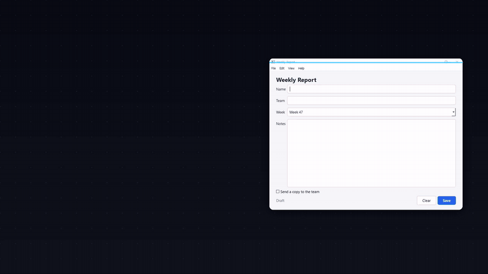

# OnceMacro

**Your AI looks at the screen, builds the macro, and fixes it — then it runs on its own.**



1-minute video with sound (mp4 download): [English](media/demo/oncemacro_story_en.mp4?raw=true) · [한국어](media/demo/oncemacro_story_ko.mp4?raw=true) · 한국어 설명: [README.ko.md](README.ko.md)

Tell your AI agent (Claude Code, Codex, ...) what to automate. It looks at the window, writes the macro, runs it and fixes what breaks; from then on the macro repeats without AI — no tokens.

OnceMacro is a Windows desktop automation program with an MCP server. Agents such as Claude Code,
Codex, Gemini CLI or Cursor use it to look at a window, find buttons and fields **by name**, test each
step, and save the result as a macro. The macro then runs on its own: no tokens, no screenshots sent
anywhere, the same steps every time. If a long-running macro gets stuck, the program notices it, tries
fixes on its own, and only then (if you allow it) asks the AI once.

## Install (one line, PowerShell, no admin)

```powershell
irm https://raw.githubusercontent.com/j-dev-team/oncemacro/main/install.ps1 | iex
```

This unpacks the program to `%LOCALAPPDATA%\OnceMacro` and registers the MCP server with Claude Code
and Codex if they are installed. Or download the zip from Releases, unpack anywhere, run `app\OnceMacro.exe`.

Then ask your agent, for example:

> Using the macro tools, make a macro that types today's date into Notepad and saves the file.

## Why not let the AI click every time?

Measured on one PC (Windows 10, Claude Code with its default model, cost at list price). Method and raw data:
[docs/en/BENCHMARK.md](docs/en/BENCHMARK.md) — anyone can rerun it with `scripts/bench_ai_vs_macro.py`.

| Task (one run) | AI does it every time | Macro built once by the AI |
|---|---|---|
| Notepad: type a line and save | 15.1 s, $0.137 (5/5) | 1.08 s, $0 (100/100) |
| Calculator: a × b | 20.0 s, $0.159 (5/5) | 3.68 s, $0 (100/100) |
| Building the macro (once) | – | 18.5 s / 26.6 s, $0.17 / $0.20 |

100 Notepad runs: about 25 min and $13.70 with the AI every time, about 2 min and $0.17 with a macro.

## What it can do

- **Windows apps by element name** (UI Automation): classic Win32, Explorer, Office, dialogs, Store apps.
  Element names usually stay the same across resolution, DPI scaling and theme changes (so far tested on one PC).
  Pictures and colors for apps that draw their own UI.
- **Background mode** (see below): runs on a window that is behind other windows, without taking your
  screen, focus or mouse — including the Save As dialog and key combos like Ctrl+Shift+S. **Run hidden** keeps
  the target window off your screen while the macro runs, and a minimized window keeps working too
  (pictures, position clicks and screen reading included; measured limits below).
- **Web pages** by element (browser automation), **Excel / Word / Hangul (HWP)** documents by cell, bookmark
  and field name, files, clipboard, PDF text, mail.
- **Unstick**: notices loops (same step on the same screen), saves evidence, tries closing popups /
  a recovery macro / resting, remembers what worked, and asks the AI only if nothing else helps.
- A full GUI editor (English and Korean), recorder, scheduler, hotkeys, run history.

## Background mode — keep using your PC while it works

Most automation tools need the target window in front and move your real mouse. With **Run in background**,
an OnceMacro macro works on a window that is behind other windows, while you keep typing somewhere else.
It works with UI elements by name, and also with pictures and window positions for apps that have no UI
element information (we run it with a custom-drawn app).

**Run hidden and minimized windows.** Turn on **Run hidden** and the target window stays off your screen
while the macro runs; it comes back as it was at the end — also after an error or a stop, and within seconds
if OnceMacro itself is closed suddenly. If the target window is minimized, background mode brings it back out
of sight when a step needs to look at it or click by position, and minimizes it again at the end.

Measured on one PC (Windows 10), each cell run 5 times in background mode while another window had focus.
"Screen updates" = a capture taken after typing differs from the one before, while the window is out of sight.

| App · window state | Find picture | Click by position | Type text | Capture | Screen updates |
|---|---|---|---|---|---|
| Notepad · behind others | 5/5 | 5/5 | 5/5 | 5/5 | 5/5 |
| Notepad · Run hidden | 5/5 | 5/5 | 5/5 | 5/5 | 5/5 |
| Notepad · minimized | 5/5 | 5/5 | 5/5 | 5/5 | 5/5 |
| Excel · behind others | 5/5 | 5/5 | 5/5 | 5/5 | 5/5 |
| Excel · Run hidden | 5/5 | 5/5 | 5/5 | 5/5 | 5/5 |
| Excel · minimized | 5/5 | 5/5 | 1/5 (retest 2/5) ¹ | 5/5 | 5/5 |
| Calculator · behind others | 5/5 | 0/5 ² | 5/5 | 5/5 | 5/5 |
| Calculator · Run hidden | 5/5 | 0/5 ² | 5/5 | 5/5 | 5/5 |
| Calculator · minimized | 5/5 | 0/5 ² | 0/5 | 5/5 | 5/5 |
| File Explorer · each of the three | 5/5 | not tested | not tested | 5/5 | not tested |
| A custom-drawn game window · Run hidden / minimized | 5/5 | not tested | not tested | 5/5 (not black) | 5/5 |

After every run above the window was back in its original state (220/220).
¹ Typing without clicking first: a minimized Excel loses track of the selected cell. Clicking a cell first
(position or element) works 5/5, and Excel steps (cells by name) do not need the screen at all.
² Calculator (a Store app) ignores position clicks in background mode even when it is only covered; press its
buttons by element name instead.

Element steps with Notepad, 5 runs each (behind others / minimized): type into the text field by element name
and save with File > Save 5/5 / 5/5; Save As dialog 5/5 / not measured; Ctrl+Shift+S 5/5 / not measured;
100 element saves back to back 100/100 (behind others).

Turn it on per macro: editor → target window → **Run in background**. If a program does not start in
background mode or your security software objects, turn on **Compatibility mode** for that macro.
In macro JSON: `"window": {"title": "...", "background": true}` (add `"hidden": true` to run hidden, and
`"wrapper": false` for compatibility mode).

About antivirus: background mode works closely with other programs' windows, and some antivirus products watch
that kind of behaviour, so they may flag `OnceMacro.exe`. OnceMacro only works with the window a macro names,
and only while that macro runs. If it is flagged, add the OnceMacro folder to your antivirus exceptions, or use
**Compatibility mode** for that macro.

Background mode's input part and Run hidden ship in the release builds; a build made from this source tree has
the screen side only.

## Honest comparison

| | OnceMacro | Windows-MCP | Power Automate Desktop | AI computer use |
|---|---|---|---|---|
| AI builds the flow | yes (MCP) | – | Copilot (preview, US) | – |
| Replays without AI | yes | no | yes | no (pays per run) |
| AI repair when stuck | yes (optional, remembers fixes) | no | self-healing (preview, premium) | – |
| Background, no focus stealing | yes: covered, hidden or minimized windows (limits measured above) | no | unattended bot (paid) | – |
| Price | free | free | free tier / $15+ per user | per token |

Others are ahead in some ways: Windows-MCP is far more widely used, Power Automate ships with Windows,
and AI computer use handles screens it has never seen. OnceMacro is for tasks you repeat.

## Limits

- Windows only. Apps that draw their own UI (games) need picture targets.
- Minimized windows: some apps lose their keyboard focus (Excel typing without clicking first 1/5, Calculator
  typing 0/5); click a field first or use element / Excel steps. Calculator ignores position clicks in
  background mode.
- In background mode, some Excel dialog text boxes ignore typed text; pick values from their lists instead.
- When nobody touches the PC for a few minutes, Windows lets a target app jump to the front for a moment;
  OnceMacro puts your window back within about 0.2 s.

## Docs

- [Getting started](docs/en/GETTING_STARTED.md) · [Connect your AI agent](docs/en/AI_CONNECT.md) ·
  [Benchmark](docs/en/BENCHMARK.md) · Agent skill: [skills/windows-macro/SKILL.md](skills/windows-macro/SKILL.md)

Stop any macro with **Ctrl+Shift+F12**. OnceMacro will not automate logins, payments or account changes,
and blocks typing into password fields.

## Feedback

Stuck or found a bug? Use **Help → Send feedback / report a problem** in the program. It builds a small zip on your PC
(version, Windows version, self-test result, recent errors, a summary of recent runs) and opens the issue page.
Screenshots and your macro files are added only if you tick them. Nothing is sent automatically —
you look at the zip and attach it yourself.

License: Apache-2.0 (see [LICENSE](LICENSE)). Bundled libraries: [THIRD_PARTY_NOTICES.md](THIRD_PARTY_NOTICES.md).
